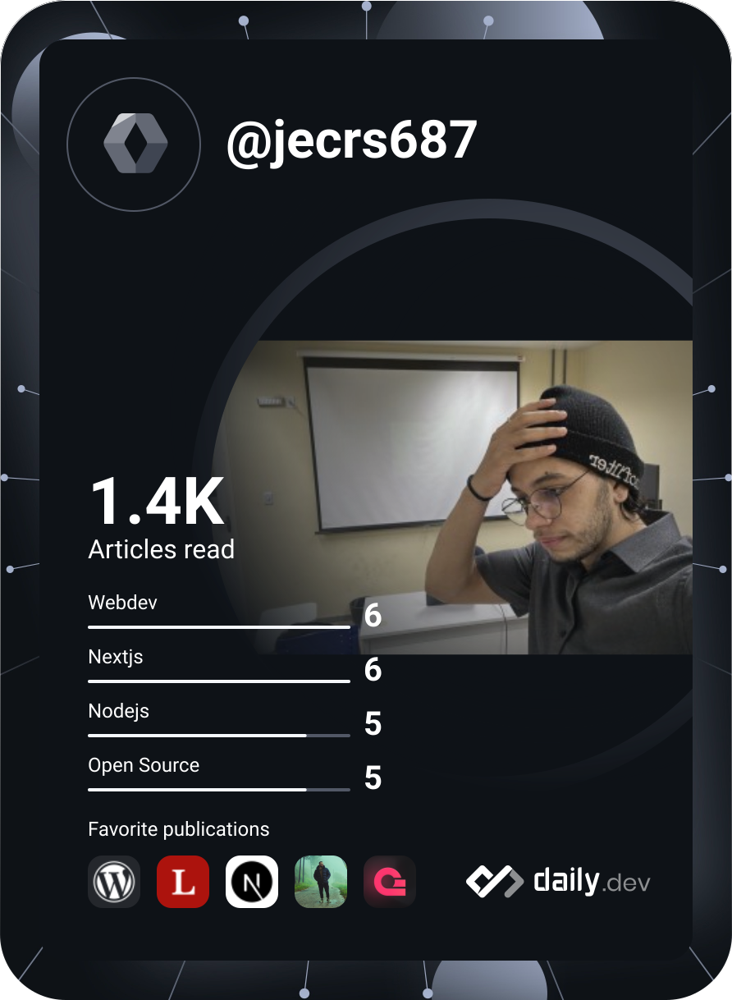

[](https://telegram.me/jecrs687)
[](https://www.messenger.com/t/jecrs687)
[](https://discordapp.com/users/551785804888932354)
[](https://www.instagram.com/jecrs687/)
[](https://www.linkedin.com/in/jecrs687/)

[](https://git.io/typing-svg)

Hello, I'm Emanuel, a passionate about new technologies! <a href="https://www.gautamkrishnar.com/"></a>

- 🍃 I’m currently working with NextJS, .Net, Capacitor, NestJS, typescript...
- 📫 How to reach me: emanuelcascone@gmail.com
- ⚡ Fun fact: I love music, languages, animes, classic books and playing piano/guitar.
- I have:
  - [tesify](https://tesify.app) (+20.000 users)
  - [iquit](https://iquitnow.life) (1st app on playstore searching iquit)
  - [Authenova](https://authenova.site) (1st mcp seo authomation with high quality)
  - [CampaignOS](https://campaignos.site) (full authomation platform for marketing)
- 🫣 ReadME: 

<table cellspacing="0" cellpadding="0" style="width: fit-content; border:0; max-width: fit-content">
        <tr>
                <td>
                        <a href="https://app.daily.dev/jecrs687">
                                
                        </a>
                </td>
                <td>
                        <table style="width: fit-content; border:0;">
                                <tr>
                                        <a href="https://github.com/jecrs687">
                                                
                                        </a>
                                </tr>
                          <br/>
                                <tr>
                                        <a href="https://github.com/jecrs687">
                                               
                                        </a> 
                                </tr>
                          <br/>
                                <tr> 
                                              <a href="https://github.com/jecrs687">
                                                                   </a><a
                                                                  href="https://spotify-github-profile.vercel.app/api/view?uid=31tl7hwnjbfgpjinrrnzwnitba7e&redirect=true">
                                                          </a>       
                                </tr>
                        </table>
                </td>
        </tr>
</table>

<!--START_SECTION:waka-->


**🐱 My GitHub Data** 

> 📦 1.4 MB Used in GitHub's Storage 
 > 
> 🏆 3,811 Contributions in the Year 2026
 > 
> 💼 Opted to Hire
 > 
> 📜 38 Public Repositories 
 > 
> 🔑 62 Private Repositories 
 > 
**I'm an Early 🐤** 

```text
🌞 Morning                282 commits         █████░░░░░░░░░░░░░░░░░░░░   20.19 % 
🌆 Daytime                511 commits         █████████░░░░░░░░░░░░░░░░   36.58 % 
🌃 Evening                328 commits         ██████░░░░░░░░░░░░░░░░░░░   23.48 % 
🌙 Night                  276 commits         █████░░░░░░░░░░░░░░░░░░░░   19.76 % 
```
📅 **I'm Most Productive on Tuesday** 

```text
Monday                   176 commits         ███░░░░░░░░░░░░░░░░░░░░░░   12.60 % 
Tuesday                  342 commits         ██████░░░░░░░░░░░░░░░░░░░   24.48 % 
Wednesday                117 commits         ██░░░░░░░░░░░░░░░░░░░░░░░   08.38 % 
Thursday                 241 commits         ████░░░░░░░░░░░░░░░░░░░░░   17.25 % 
Friday                   101 commits         ██░░░░░░░░░░░░░░░░░░░░░░░   07.23 % 
Saturday                 159 commits         ███░░░░░░░░░░░░░░░░░░░░░░   11.38 % 
Sunday                   261 commits         █████░░░░░░░░░░░░░░░░░░░░   18.68 % 
```


📊 **This Week I Spent My Time On** 

```text
💬 Programming Languages: 
Other                    35 hrs 7 mins       ████████████░░░░░░░░░░░░░   49.70 % 
Markdown                 9 hrs 28 mins       ███░░░░░░░░░░░░░░░░░░░░░░   13.40 % 
TypeScript               8 hrs 54 mins       ███░░░░░░░░░░░░░░░░░░░░░░   12.60 % 
Python                   4 hrs 20 mins       ██░░░░░░░░░░░░░░░░░░░░░░░   06.13 % 
JavaScript               3 hrs 56 mins       █░░░░░░░░░░░░░░░░░░░░░░░░   05.57 % 

🐱‍💻 Projects: 
thesify                  22 hrs 5 mins       ████████░░░░░░░░░░░░░░░░░   31.26 % 
authenova-web            15 hrs 32 mins      █████░░░░░░░░░░░░░░░░░░░░   21.99 % 
be-monorepo              9 hrs 36 mins       ███░░░░░░░░░░░░░░░░░░░░░░   13.59 % 
authenova                8 hrs 10 mins       ███░░░░░░░░░░░░░░░░░░░░░░   11.56 % 
meetnow                  1 hr 39 mins        █░░░░░░░░░░░░░░░░░░░░░░░░   02.35 % 

💻 Operating System: 
Mac                      70 hrs 41 mins      █████████████████████████   100.00 % 
```

🤖 **AI Coding This Week** 

```text
⏱ AI Coding Time: 68 hrs 55 mins (97.52%)

✍️ 151,143 lines written by AI, 142 lines written by hand (99.91% AI-written)

🔤 137,248,622 Input Tokens, 15,312,234 Output Tokens

💵 $1531.95 Estimated AI Cost This Week

🧠 3277 AI Sessions, 3566 AI Prompts

Opus                     148,108 lines       ████████████████████████░   96.07 % 
Fable                    5,788 lines         █░░░░░░░░░░░░░░░░░░░░░░░░   03.75 % 
GPT                      272 lines           ░░░░░░░░░░░░░░░░░░░░░░░░░   00.18 % 
Gemini                   0 lines             ░░░░░░░░░░░░░░░░░░░░░░░░░   00.00 % 
Sonnet                   0 lines             ░░░░░░░░░░░░░░░░░░░░░░░░░   00.00 % 

🔎 AI Coding Insights:
🤖 AI-Driven — 99.91% of written lines came from AI
📄 Detailed Prompter — average 1,286 characters per prompt
🎯 One-Shot Prompter — average 1 prompts per session
🚀 High AI Trust — 0.15% of changed lines were hand-edited
```

**I Mostly Code in TypeScript** 

```text
TypeScript               59 repos            ███████████░░░░░░░░░░░░░░   45.04 % 
C#                       8 repos             ██░░░░░░░░░░░░░░░░░░░░░░░   06.11 % 
Python                   5 repos             █░░░░░░░░░░░░░░░░░░░░░░░░   03.82 % 
HTML                     3 repos             █░░░░░░░░░░░░░░░░░░░░░░░░   02.29 % 
PHP                      1 repo              ░░░░░░░░░░░░░░░░░░░░░░░░░   00.76 % 
```


 Last Updated on 01/11/2026 05:06:57 UTC
<!--END_SECTION:waka-->

### 📖 My articles on medium

  [](https://github-readme-medium-recent-article.vercel.app/medium/@jecrs687/0)

📕 &nbsp;**Latest Blog Posts**

<!-- BLOG-POST-LIST:START -->
- [Enhancing Small Business Infrastructure: Practical and Cost-effective Strategies](https://dev.to/jecrs687/enhancing-small-business-infrastructure-practical-and-cost-effective-strategies-477l)
- [Create an AMAZING readme for your github profile](https://dev.to/jecrs687/create-a-amazing-readme-for-your-github-profile-3jj0)
- [Unlock Your Potential: 3 Game-Changing GitHub Repositories You Need to Explore Today!](https://dev.to/jecrs687/best-repositories-to-learn-something-different-487c)
- [How to Maximize Your Profit Mining Chia: Insider Tips to Save Money and Boost Performance](https://dev.to/jecrs687/como-aumentar-o-lucro-com-a-chia-para-pequenos-fazendeiros-ou-iniciantes-1o2b)
- [Unlock the Full Potential of Your Storage: Boost Performance with MergerFS and RAID 0!](https://dev.to/jecrs687/criar-plots-em-ssds-com-menos-de-249g-livres-linux-2o0e)
<!-- BLOG-POST-LIST:END -->

## Languages and tools

  [](https://skillicons.dev)
  

[](https://wakatime.com/@777fc214-6eb8-4627-8c93-467c3ac7e028)
